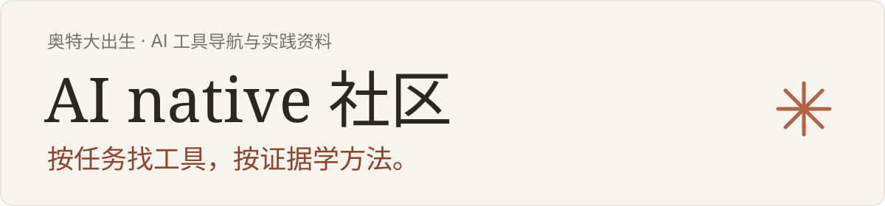
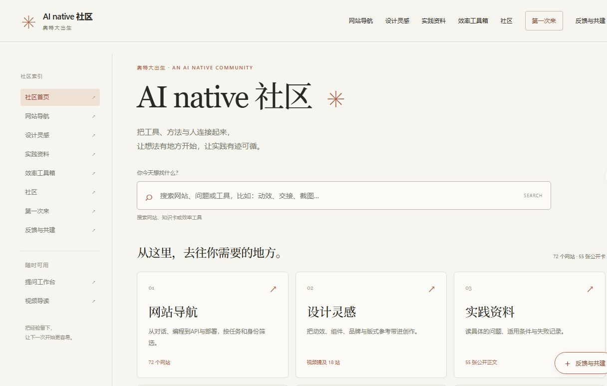

<div align="center">



# AI native 社区

奥特大出生的公开 AI 实践与共建入口。

[进入社区](https://api.190675.xyz/ai-hub/) · [第一次来](https://api.190675.xyz/ai-hub/start/) · [网站导航](https://api.190675.xyz/ai-hub/tools/) · [反馈与共建](https://api.190675.xyz/ai-hub/feedback/)

[](https://github.com/zxs4KHf/ai-native-community/actions/workflows/ci.yml)

**72 个网站** · **55 张公开知识卡** · **9 个效率工具** · **10 个独立页面**

<sub>目录快照：2026-10-19。数量表示收录，不表示已验证效果或安全性。</sub>

</div>

## 从你现在要做的事开始

| 我想…… | 去这里 | 可以做什么 |
| --- | --- | --- |
| 第一次试试 AI | [从一步开始](https://api.190675.xyz/ai-hub/start/) | 用已有应用完成一个可检查的小任务，无需先学 API 或 Agent |
| 按需求找工具 | [网站导航](https://api.190675.xyz/ai-hub/tools/) | 搜索、分类、身份与使用标记筛选；常用入口排在前面 |
| 找一份设计参考 | [设计灵感](https://api.190675.xyz/ai-hub/design/) | 按动效、界面、品牌等场景浏览 19 个资源 |
| 学具体的方法 | [实践资料](https://api.190675.xyz/ai-hub/guides/) | 阅读六专题正文、适用条件、成本与失败边界 |
| 解决日常小痛点 | [效率工具箱](https://api.190675.xyz/ai-hub/toolbox/) | 按截图、文件、窗口等场景挑选，区分站长推荐与待评价 |
| 分享经验或提建议 | [社区](https://api.190675.xyz/ai-hub/community/) / [反馈](https://api.190675.xyz/ai-hub/feedback/) | 了解贡献方式，提交体验、建议、Bug 或网站推荐 |

还有 [提问工作台](https://api.190675.xyz/ai-hub/workshop/) 和 [视频导读](https://api.190675.xyz/ai-hub/videos/)；首页可同时搜索网站、知识卡和效率工具。


## 导航里有什么

常用、在用和站长推荐分别标注。ChatGPT、Claude、Net.Coffee、ModelTrace、Gemini、WorkBuddy 默认在前排；可切换筛选和排序，单站链接可直接分享。WorkBuddy 国内与海外共用一张卡，分别提供入口。

<details>
<summary><strong>展开 10 类网站目录</strong></summary>

| 分类 | 入口 |
| --- | --- |
| 通用对话 | [找对话应用](https://api.190675.xyz/ai-hub/tools/?siteCategory=conversation#sites) |
| 搜索研究 | [找检索与比较工具](https://api.190675.xyz/ai-hub/tools/?siteCategory=research#sites) |
| 编程 Agent | [找编程与开发辅助](https://api.190675.xyz/ai-hub/tools/?siteCategory=coding#sites) |
| API 与中转 | [核对开发平台与第三方身份](https://api.190675.xyz/ai-hub/tools/?siteCategory=api#sites) |
| 视频音频 | [找媒体创作工具](https://api.190675.xyz/ai-hub/tools/?siteCategory=media#sites) |
| 办公文档 | [找文档与办公应用](https://api.190675.xyz/ai-hub/tools/?siteCategory=office#sites) |
| 自动化与知识库 | [找流程与知识整理工具](https://api.190675.xyz/ai-hub/tools/?siteCategory=automation#sites) |
| 设计学习 | [找视觉与设计参考](https://api.190675.xyz/ai-hub/tools/?siteCategory=design#sites) |
| AI 学习、社区与工具发现 | [继续学习与交流](https://api.190675.xyz/ai-hub/tools/?siteCategory=learning#sites) |
| 云部署与接入诊断 | [核对云端及网络接入入口](https://api.190675.xyz/ai-hub/tools/?siteCategory=cloud#sites) |

</details>

六个知识专题：工具与模型、订阅与权益、API/token 成本、Agent 工作流、创作设计、云资源部署。设计目录包含视频中的 18 个主站和既有 Eyecandy，作者评价与官网用途分开呈现。

<details>
<summary>查看实际首页截图</summary>



<sub>截图来自与公网逐字节一致的本地构建，仅包含公开页面；截图日期：2026-10-19。</sub>

</details>

## 先看来源，再作判断

条目保留公开来源、核验日期和验证范围。11 条本人邀请链接与主页并列，并披露可能获得平台奖励；两条网络服务邀请另注明含邀请返佣，不承诺服务安全或收益。良心云的注册页邀请码预填仍待复核。第三方模型探针不能证明模型真实身份，勿提交生产密钥或敏感材料。

本站为静态页面，无数据库、站内注册或分析追踪。搜索、筛选与提示词拼接在浏览器内完成，不保存或发送输入。更多说明见 [来源与边界](SOURCES.md)。

## 反馈与贡献

从 [反馈入口](https://api.190675.xyz/ai-hub/feedback/) 选择使用体验、功能建议、Bug 或网站 / Idea 推荐，会打开 GitHub 原生 Issue Forms。先 [查找重复反馈](https://github.com/zxs4KHf/ai-native-community/issues)，登录 GitHub 后检查内容并自行提交；反馈公开，截图和日志先脱敏。安全问题请参阅 [SECURITY.md](SECURITY.md)。

贡献条目请给出名称、用途、分类、公开来源与核验范围；邀请链接需要本人归属确认。贡献代码请开分支和 PR，附上改动说明与验证结果，等 CI 通过后合并。详见 [CONTRIBUTING.md](CONTRIBUTING.md)。

## 本地运行

需要 **Node.js 24+** 和 Git，无第三方运行依赖，无需配置密钥。

```sh
git clone https://github.com/zxs4KHf/ai-native-community.git
cd ai-native-community
npm run build
npm run check
npm start
```

打开启动命令打印的 `http://127.0.0.1:实际端口/ai-hub/`。修改后重新构建并重启预览。

```text
data/ + source/ → npm run build → public/ + assets.mjs → npm run check
```

公开数据在 `data/`，排版与交互在 `source/`；构建输出 10 页、14 个白名单资源。检查覆盖既有条目、排序、邀请参数、内链、隐私边界及请求方法隔离。

## 发布与回滚

源码使用 **分支 → PR → 无密钥 CI → main → 维护者授权发布** 的流程。PR 和 main 均运行同一套构建、检查及生成产物一致性校验。可用 GitHub CLI 查看实际状态：

```sh
gh pr checks --watch
gh run list --repo zxs4KHf/ai-native-community --branch main --workflow ci.yml --limit 5
```

生产发布由维护者已有的本地授权适配器执行，适配器和凭据不放入公开仓库。它在 main CI 成功后，仅更新独立 `aote-ai-hub` 的 `/ai-hub/*` 路由，并回读全部公开资源、核对原问卷与其他服务。发布前保留内容快照；回滚时以备份或前一 Git 提交重建，保留路由身份并重新验证。
